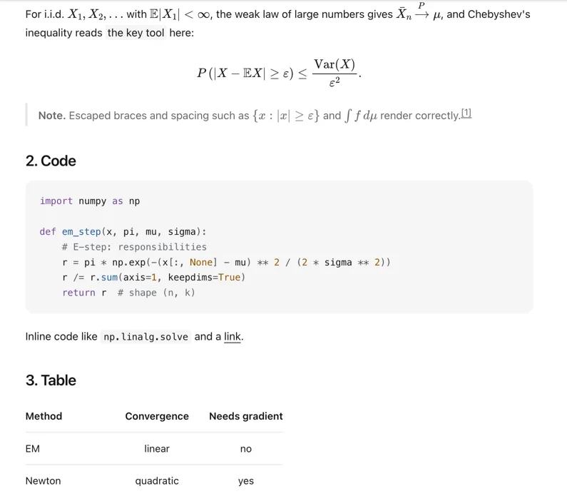
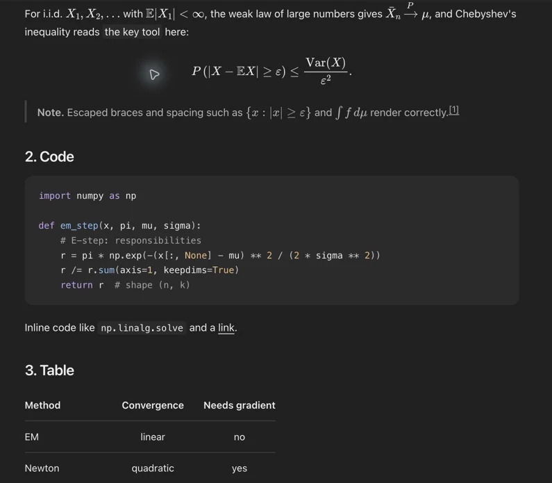

# Still & Clay

Two reading themes for the [Markdown Viewer](https://github.com/simov/markdown-viewer) browser extension. Made for notes, code and mathematical writing; both follow your system's light / dark appearance.

两款面向 Chrome Markdown Viewer 的阅读主题：**Still（留白）** 是简洁的黑白灰；**Clay**保留温暖的纸张质感。

| Theme | Character | CSS | Preview & guide |
| --- | --- | --- | --- |
| **Still · 留白** | Neutral white / charcoal, focused typography, quiet code blocks | [Download still.css](themes/still/still.css) | [Guide](themes/still/README.md) · [HTML preview](themes/still/preview.html) |
| **Clay** | Warm off-white / warm gray, paper-like reading | [Download clay.css](clay.css) | [Original guide](themes/clay/README.md) |

Still draws inspiration from the reading experience of ChatGPT / Codex. It is an independent, unofficial theme, not a copy of proprietary source code or an OpenAI product.

## Install / 安装

1. Install [Markdown Viewer for Chrome](https://chromewebstore.google.com/detail/markdown-viewer/ckkdlimhmcjmikdlpkmbgfkaikojcbjk).
2. Download the CSS for your chosen theme (open its GitHub page and use the raw-file download button).
3. Open **Advanced Options → Settings**, select **Content Theme → CUSTOM**, then **ADD / UPDATE** and choose the CSS file.
4. Set **Color Scheme → AUTO** and **Content Width → AUTO**, then reload the Markdown tab.
5. For local notes, enable **Allow access to file URLs** in Chrome → Extensions → Markdown Viewer → Details.

Only one custom theme is active at a time. Switch between Still and Clay by uploading the other CSS. Upload again after updating a file; the extension stores its own copy.

主题只改变 Markdown 正文，不改变扩展的设置页面。上传后请打开 `.md` 文件查看效果。

### Recommended settings

| Section | Options | Value |
| --- | --- | --- |
| Theme | Content Width / Color Scheme | AUTO / AUTO |
| Content | `mathjax`, `toc`, `autoreload`, `syntax` | on |
| Compiler (markdown-it) | `cjk`, `footnote`, `mark`, `tasklists` | on |

## Preview

| Still · Light | Still · Dark |
| :---: | :---: |
|  |  |

Actual Chrome Markdown Viewer captures. Dark appearance was checked with browser media emulation; no system appearance settings were changed.

- Still: download the repository and open [`themes/still/preview.html`](themes/still/preview.html); use the appearance selector for light / dark previews. For actual extension rendering, open [`themes/still/sample.md`](themes/still/sample.md).
- Clay: the original [`sample.md`](sample.md), [`clay.css`](clay.css) and screenshots are retained unchanged.

| Clay · Light | Clay · Dark |
| :---: | :---: |
|  |  |

## Project layout

```text
clay.css                  Original Clay theme (compatible path)
sample.md                 Original Clay sample
screenshots/              Original Clay screenshots
themes/clay/README.md     Original Clay guide and creation notes
themes/still/still.css    Still theme
themes/still/preview.html Standalone appearance preview
themes/still/sample.md    Extension rendering sample
scripts/sync_preview.py   Refresh preview CSS after edits
```

## Development

The CSS files are self-contained; no build tools or downloaded fonts are needed. After editing Still, run `python3 scripts/sync_preview.py`. Keep the uploaded CSS below the extension's 8KB limit. Check light and dark appearance, narrow windows, long code lines, tables, formulas and the ToC before release.

Local working directory: `/Users/hejunyi/Documents/codexspace/markdown-viewer-themes`.

## License

[MIT](LICENSE). Original Clay theme and license retained. See the [Clay guide](themes/clay/README.md) for the original creation notes.
