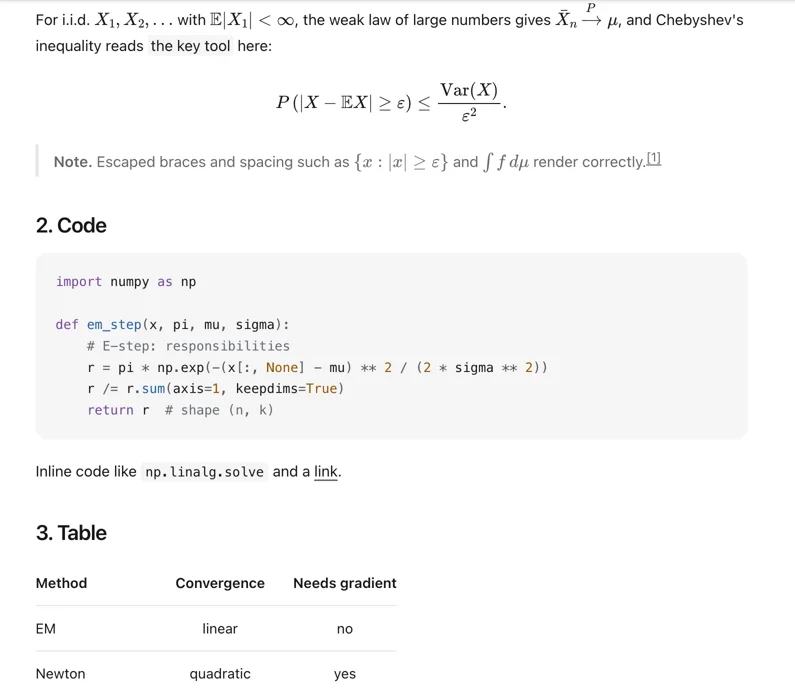
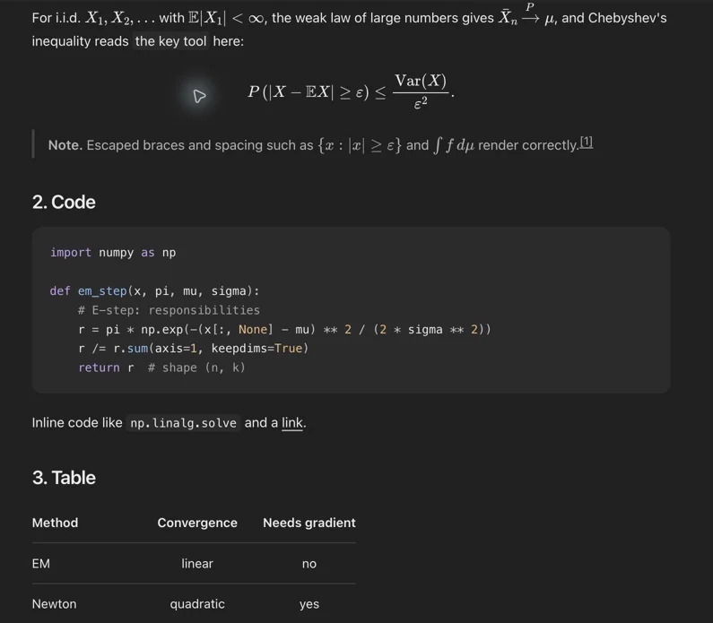

# Still

A quiet, monochrome reading theme for Markdown Viewer. Inspired by the calm typography of ChatGPT and Codex, without their branding or application chrome. Unofficial; no proprietary fonts or remote assets.

Neutral colors, generous spacing and soft code backgrounds keep the focus on your writing. Designed for English and Chinese notes, code and mathematical reasoning.

| Light | Dark |
| :---: | :---: |
|  |  |

## Install

1. Download [`still.css`](still.css).
2. Markdown Viewer → **Advanced Options → Settings**.
3. Set **Content Theme → CUSTOM**, click **UPDATE** (or ADD), and choose `still.css`.
4. Set **Color Scheme → AUTO** and **Content Width → AUTO**. Reload your Markdown tab.
5. For local files, enable **Allow access to file URLs** in Chrome's extension details.

After editing the CSS, upload it again with UPDATE: the extension stores a copy and does not watch the file on disk. AUTO follows your operating system appearance. The extension's LIGHT / DARK setting does not manually switch this theme's CSS palette.

## Design

- 15px system sans-serif body, 1.75 line height, 768px maximum outer width with 28px side padding.
- White / charcoal backgrounds, neutral inline code and restrained syntax colors.
- Heading hierarchy without divider lines; tables with horizontal rules and preserved Markdown column alignment.
- Scrollable code, tables and display math; visible keyboard focus; compact footnotes.
- The table of contents hides below 900px so it cannot squeeze the reading column. It returns on wider windows.
- No scripts or external resources in the uploaded CSS. Under 8KB even before minification.

## Preview

Open [`preview.html`](preview.html) for an offline light / dark / system preview. It embeds a copy of the release CSS and does not load MathJax or the extension.

Open [`sample.md`](sample.md) in Chrome with Markdown Viewer for the actual compiler, Prism, MathJax and ToC behavior. Recommended settings: `syntax`, `mathjax`, `toc`, `autoreload`, `cjk`, `footnote`, `mark`, `tasklists` enabled.

After editing `still.css`, run `python3 scripts/sync_preview.py` from the repository root to refresh the embedded preview styles.

This theme styles Markdown content, not the extension's settings screen. It cannot add a functional code-copy button or change the extension's math rendering inside ToC headings.

## License

[MIT](../../LICENSE). Adapted from Clay by Junyi He.
